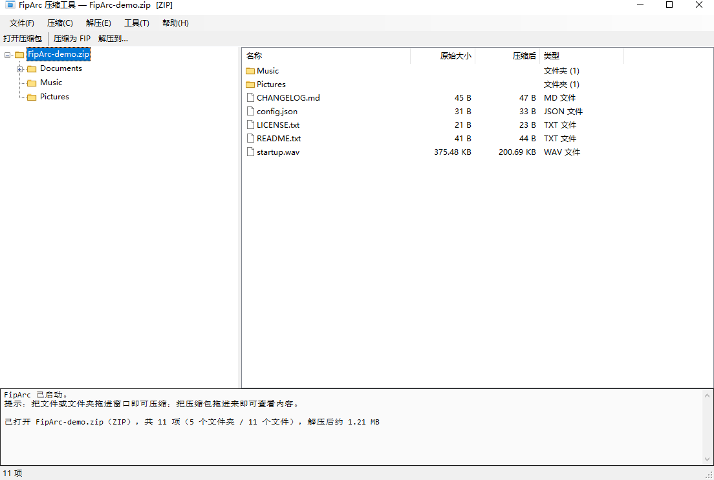
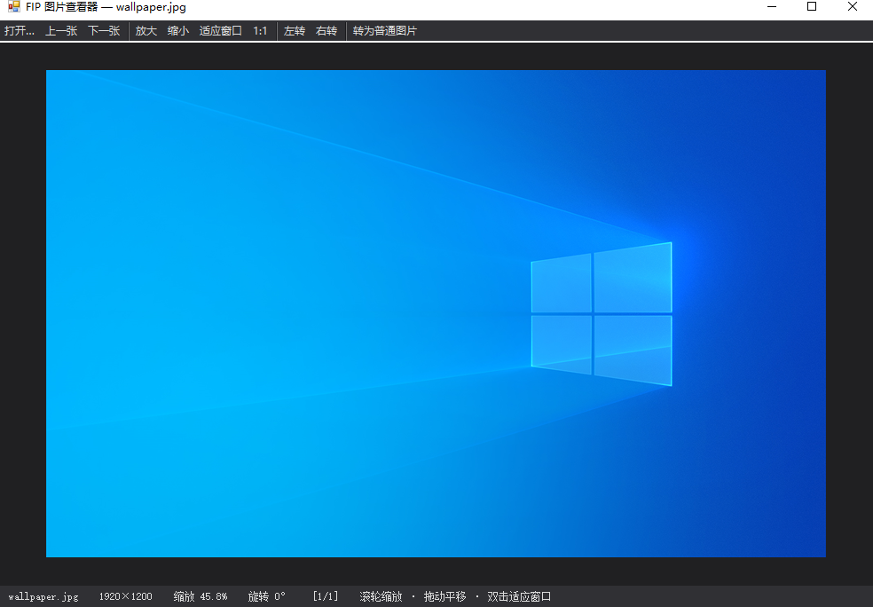

# FipArc

**A Windows archiver with its own format `.fip`, an Explorer-style archive browser, and a built-in image viewer / text editor.**

> Windows 压缩工具，自带 `.fip` 专有格式、资源管理器式压缩包浏览、内置看图 / 文本编辑器。

[](LICENSE)


---

## Features / 功能

- **Archive browser** — folder tree on the left, file details on the right, just like Explorer.
  Browse `.zip` `.7z` `.rar` `.tar` `.gz` `.bz2` `.xz` `.iso` `.cab` `.jar` and `.fip` without extracting.
- **Drag files out** — drag files **or whole folders** from the archive straight into Explorer.
  Encrypted archives ask for the password first.
- **Its own format `.fip`** — AES-encrypted headers and payload.
- **Compress to** `.fip` `.zip` `.tar` `.gz` `.tar.gz`, plus 7-Zip / RAR support through a bundled 7-Zip engine.
- **Image viewer** and **text editor** with zoom, rotate, save — for files inside archives too.
- **Per-user install** to `%APPDATA%\FipArc` — **no administrator rights needed**.
- **7 languages** — English, 日本語, 한국어, Español, Русский, 繁體中文, 简体中文.
  Chosen at install time, changeable in **Tools → Language**.

## Screenshots

| Archive browser / 压缩包浏览 | Image viewer / 图片查看 |
|---|---|
|  |  |

Folder tree on the left, file details on the right — browse `.zip` `.7z` `.rar` `.fip`
without extracting, then drag anything out into Explorer.

左边文件夹树、右边文件详情 —— 不用解压就能浏览，还能直接拖到资源管理器。

---

## Download / 下载

Grab `FipArcSetup.exe` from [Releases](../../releases). Single file, no dependencies.

> 从 [Releases](../../releases) 下载 `FipArcSetup.exe`，单文件，无需额外依赖。

**Requirements / 环境要求**

| | |
|---|---|
| OS | Windows 7 SP1 / 8 / 8.1 / 10 / 11 (x64) |
| Runtime | .NET Framework 4.8 (included in Windows 10 1903+ / 11) |
| Disk | ~10 MB |

---

## Build / 构建

No Visual Studio or MSBuild required — only the C# compiler that ships with Windows.

无需 Visual Studio / MSBuild，只用系统自带的 C# 编译器。

```bat
build.cmd
:: -> build\FipArcSetup.exe
```

One command, one output: a self-contained `FipArcSetup.exe` (~4 MB).

> Earlier versions shipped two editions; the SE edition replaced the full one
> in 1.1.0 and is now the only build. 早期版本有完整版和 SE 两个版本，
> 从 1.1.0 起 SE 取代完整版，现在只有一个版本。

See [docs/BUILD.md](docs/BUILD.md) for details on the compiler flags, embedded resources
and the third-party binaries you need to download yourself.

---

## Command line / 命令行

```
FipArc.exe                      Open the main window
FipArc.exe /open  <file>        Open an archive, media file, image or text file
FipArc.exe /pack  <file>...     Compress the given paths
FipArc.exe /extract <file>      Extract an archive
FipArc.exe /tray                Start minimised

FipArcSetup.exe                 Installer
FipArcSetup.exe /quiet [/dir=<path>]
FipArcSetup.exe /uninstall [/quiet]
```

---

## File associations / 文件关联

FipArc only claims **`.fip`** by default. Everything else (`.zip`, `.7z`, `.mp3`, `.txt`, …)
stays exactly as your system has it.

FipArc 默认**只接管 `.fip`**，其它格式（`.zip`、`.7z`、`.mp3`、`.txt`…）一律保持你系统的原样。

Anything previously written into the registry by older versions is cleaned up on install,
including the icon overrides — the installer keeps a backup table in
`HKCU\Software\FipArc\IconBackup` so uninstalling restores the original icons.

> Want FipArc as the default app for archives or media?
> Open **Tools → Set as default app…** — Windows will take you to the Default Apps page.

---

## Languages / 语言

| Code | Language | 表示 |
|---|---|---|
| `en` | English | English |
| `ja` | Japanese | 日本語 |
| `ko` | Korean | 한국어 |
| `es` | Spanish | Español |
| `ru` | Russian | Русский |
| `zh-TW` | Traditional Chinese | 繁體中文 |
| `zh-CN` | Simplified Chinese | 简体中文 |

All UI strings live in one file: [`src/Lang.cs`](src/Lang.cs).
Each key maps to an array of 7 strings, in the order of `Lang.Codes`.

**Adding a language:**

1. Append the code to `Lang.Codes` and the native name to `Lang.Names`.
2. Add one string per key in `Lang`'s static constructor (the order must match).

Pull requests for new languages or better translations are very welcome.

---

## Project layout / 目录结构

```
FipArc/
├─ src/                     Application sources
│  ├─ Program.cs            Entry point, command line
│  ├─ MainForm.cs           Main window: split tree + details, drag-out, context menus
│  ├─ Archive.cs            Archive abstraction: zip / tar / gz / fip / 7z extractors
│  ├─ FipCore.cs            .fip container format
│  ├─ ZipCrypto.cs          ZipCrypto encryption
│  ├─ SevenZip.cs           Wrapper around the bundled 7z.exe
│  ├─ ImageViewerForm.cs    Image viewer
│  ├─ TextViewerForm.cs     Text editor
│  ├─ Playable.cs           File-kind detection
│  ├─ Shell.cs              Registry: associations, context menus, icons
│  ├─ Lang.cs               All UI strings, 7 languages
│  └─ Cache.cs              Temp-file cleanup
├─ installer/               Installer and uninstaller
├─ assets/                  Icons
├─ tests/CoreTest.cs        88 headless assertions
├─ docs/                    Build and format documentation
└─ build.cmd                One-file build script
```

---

## Tests / 测试

```bat
:: after build.cmd
build\CoreTest.exe
:: -> 通过 88 项，失败 0 项 / 88 passed, 0 failed
```

The tests cover the `.fip` round-trip, ZipCrypto, tar/gz packing, tolerant extraction,
password handling and path sanitisation — everything that does not need a UI.

---

## Contributing / 参与贡献

1. Fork, branch, commit.
2. Keep the C# at **C# 5** level — the build uses the legacy compiler that ships with
   Windows (`%WINDIR%\Microsoft.NET\Framework64\v4.0.30319\csc.exe`).
   No string interpolation, no `?.`, no expression-bodied members.
3. Run `build.cmd` and `build\CoreTest.exe` before opening a pull request.

---

## License

[MIT](LICENSE) © 2026 43086FG

Third-party components keep their own licenses:

| Component | License | Notes |
|---|---|---|
| 7-Zip (`7z.exe`, `7z.dll`) | LGPL-2.1 + unRAR restriction | Bundled unmodified; see `vendor/full/License.txt` |

The MIT license covers the FipArc sources in this repository only.
